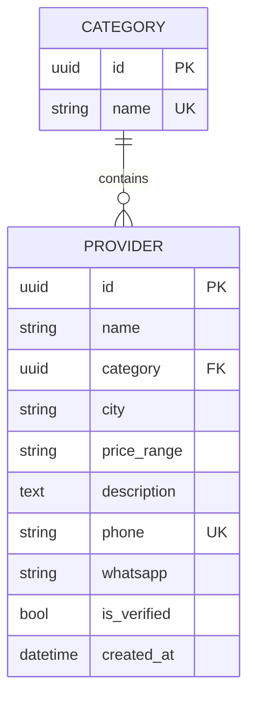

# Service Provider Catalogue (SPC)

[](https://www.python.org/)
[](https://www.djangoproject.com/)
[](https://www.django-rest-framework.org/)
[](https://www.postgresql.org/)
[](https://www.sqlite.org/)
[](https://www.docker.com/)
[](https://developer.mozilla.org/en-US/docs/Web/JavaScript)
[](LICENSE)

Design documentation for a catalogue helping event organisers in Malawi discover
service providers (decorators, caterers, MCs, photographers, sound, venues).

> Status: student demo with provisional requirements and fictional sample data.
> Never present listings as real or verified without an actual check.

## Quick start

```bash
docker compose up --build   # app at http://localhost:8080, API at :8000
```

No Docker? Python 3.13+, then from `backend/`: venv → `pip install -e .` →
`manage.py migrate` → `loaddata demo_providers` → `runserver`, and open
`frontend/index.html` (`?demo` works with no backend). Full guide: `docs/06-operations.md`.

## 1. System requirements

### 1.1 Technical requirements

**a. Languages / stack**

- Python (Django + Django REST Framework, SimpleJWT), vanilla HTML/CSS/JS
- Postgres via `DATABASE_URL`, SQLite fallback; Docker for dev and deploy

> No frontend build step, so any static host serves it.

**b. Database type**

- **Relational database**: answers documentary queries, e.g.:
  - Which providers belong to which category?
  - How many providers per category / city?
  - Which listings are verified, and which are awaiting review?

**c. Supported devices**

- Phones (mobile-first cards, 360px and up)
- Laptops/desktops (grid catalogue, staff review queue)

### 1.2 User requirements

a. **Organiser discovery**: find a suitable provider in a particular city and contact them directly
b. **Provider visibility**: be discoverable and receive enquiries without depending on social-media reach
c. **Trust signal**: tell verified listings apart from unverified ones at a glance

### 1.3 Functional requirements

a. Browsing providers with search, category, and city filters
b. Provider details with WhatsApp/phone contact actions
c. Self-registration and login (JWT), listing submission (live as unverified)
d. Staff review queue: verify or delete listings, add providers directly
e. Paginated read API with Django admin for team-managed records

### 1.4 Legal & ethical requirements

- Seed data is fictional: never present listings as real or verified without an actual check
- Contact details published only with permission; use placeholders in demos
- No secrets in the repo (`.env` files are gitignored and blocked); demo defaults are documented, not production-safe
- Passwords need 8+ characters; staff-only actions are server-guarded, not just UI-hidden

## 2. Design diagrams

- **Architecture**: interactive diagram: `docs/diagrams/spc-architecture.html` (spec: `spc-architecture.json`)
- **Workflows**: sequence diagrams for browse, submit, verify, and boot: `docs/05-workflows.md`
- **ERD**: the data model, in `docs/02-architecture.md`:



## 3. Contributors

| Role | Member |
| --- | --- |
| Project Lead | TBD |
| Backend Developer | TBD |
| Backend Developer | TBD |
| Frontend Developer | TBD |
| Frontend Developer | TBD |
| Data & Documentation | TBD |
| QA & Presenter | TBD |

Group 2 members: replace TBD with your names (and emails only if you want them public).

## 4. License

This project is licensed under the MIT License: see the [LICENSE](LICENSE) file for details.

---

Full guides live in `docs/`: 01 overview · 02 architecture · 03 API reference ·
04 frontend guide · 05 workflows · 06 operations. Backend specifics: `backend/README.md`.
