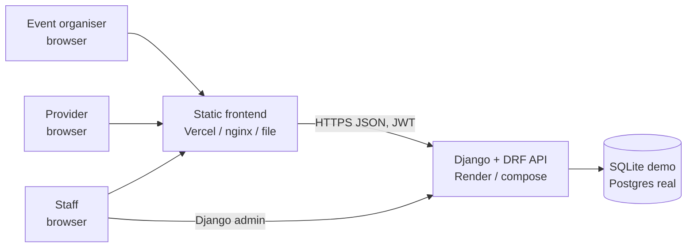
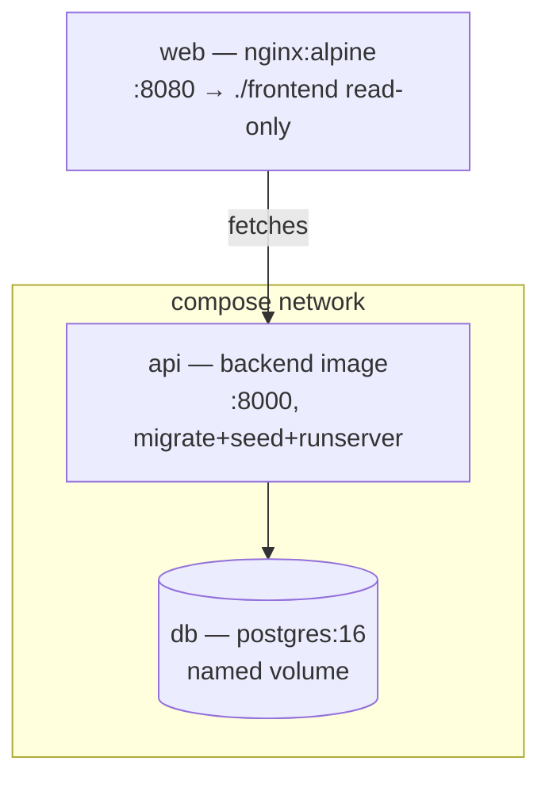
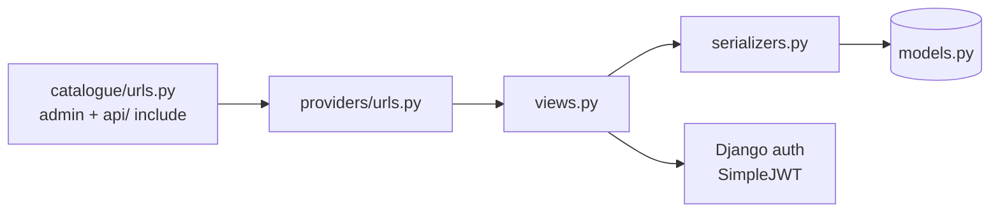
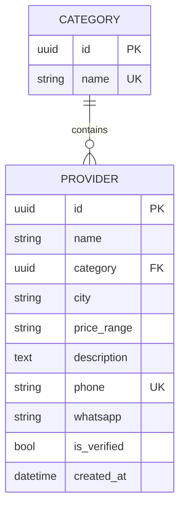
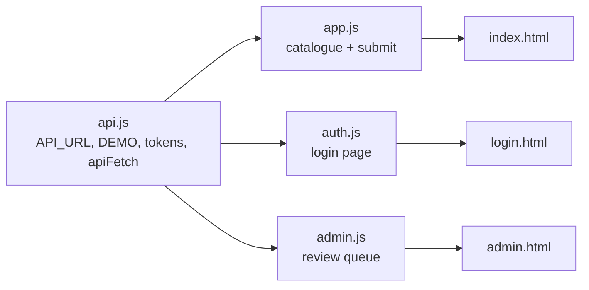

# 02: Architecture

## System context

Three deployment shapes, one codebase: local compose (Postgres + dev server +
nginx), Render (gunicorn + ephemeral SQLite or attached Postgres), and
zero-backend `?demo` mode. See `06-operations.md`.

## Containers (compose)

The production image (`backend/Dockerfile`) is the same artifact everywhere:
`pip install -e .` → `collectstatic` → boot runs `migrate` + `loaddata
demo_providers` → `exec gunicorn` on `$PORT`. Compose overrides only the
command (dev server with auto-reload over a bind mount).

## Backend modules

| File | Responsibility |
| --- | --- |
| `providers/models.py` | `CategoryModel` (UUID pk, unique name) · `ProviderModel` (UUID pk, FK `PROTECT` to category, city, price_range, description, phone as string, whatsapp, `is_verified=false` default, `created_at`) |
| `providers/serializers.py` | Nested `category` on read, `category_id` on write; `id`/`is_verified`/`created_at` read-only; `RegisterSerializer` (username + 8+ char password, never staff) |
| `providers/views.py` | `CategoryList`, `ProviderList` (manual `?category=&city=&q=` filters), `ProviderDetail`, `RegisterView` (throttled), `MeView`, `VerifyProvider` (staff-only) |
| `providers/admin.py` | Team data entry: list, filter, search |
| `providers/tests.py` | 7 tests: list/filters/health/categories + auth writes + staff gating |
| `providers/fixtures/demo_providers.json` | 6 categories + 6 fictional providers (fixed UUIDs → reloads are idempotent) |
| `providers/migrations/0004_seed_admin.py` | Creates superuser `admin` if none exists (password from `DJANGO_ADMIN_PASSWORD`, demo default otherwise) |

## Data model (ERD)

## Frontend modules

`api.js` loads first on every page (`defer` order). Token lifecycle: stored in
`localStorage`, sent as `Bearer`, refresh-once on 401, then the session is
dropped. `?api=` overrides the backend without redeploying; `?demo` serves
built-in sample data with no backend at all.

## Key decisions

1. **Read-only public API plus admin/staff writes**: keeps the MVP narrow; public
   submissions go live unverified rather than building moderation up front.
   *Trade-off:* any signed-in user can delete any listing (demo limitation).
2. **Phone as string, not integer**: preserves leading `0` and `265…` numbers
   past the 32-bit ceiling. *Trade-off:* no numeric validation; add when real data arrives.
3. **`is_verified` server-guarded, not UI-guarded**: read-only in the
   serializer plus a staff-only verify endpoint, so a forged request still fails.
4. **SQLite default, Postgres on `DATABASE_URL`**: zero-config demo, real
   persistence when attached. *Trade-off:* free-tier SQLite reseeds every deploy.
5. **No frontend build step**: any static host works, but no bundler safety net;
   `node --check` in CI is the backstop.
