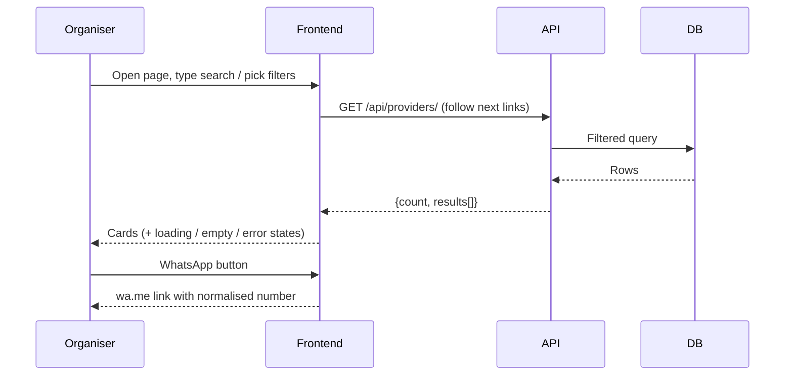
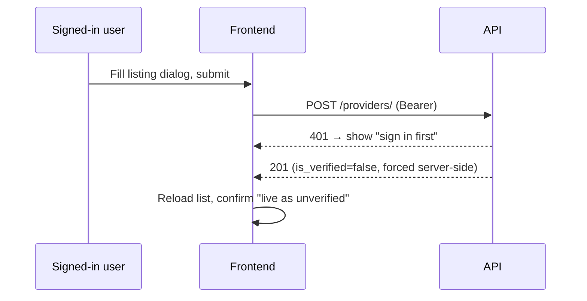
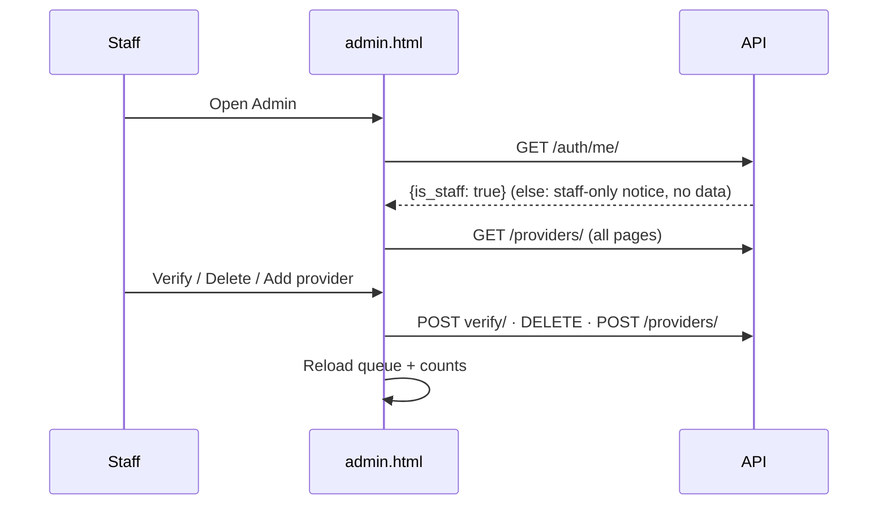
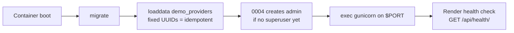

# 05: Workflows

## Browse → contact

Filtering after page 1 is client-side over the full list, which is why the
frontend follows every `next` link before rendering.

## Submit a listing

`is_verified:true` in a PATCH body is accepted by the parser and ignored by
the serializer, which is covered by test.

## Staff verify

Django `/admin/` (same staff account) remains the fallback for direct edits.

## Cold boot / deploy

Compose dev boot is the same shape with `runserver` instead of gunicorn.
